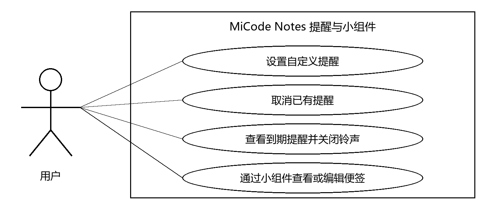
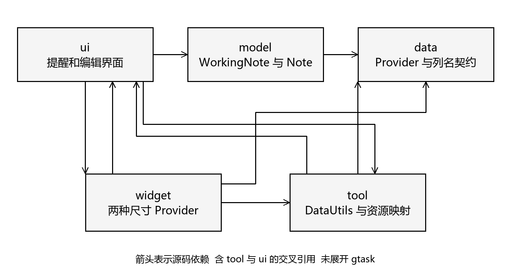
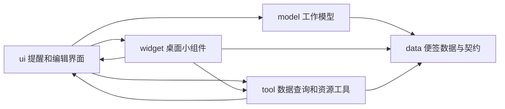
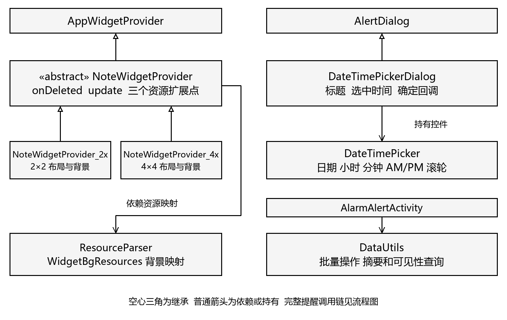
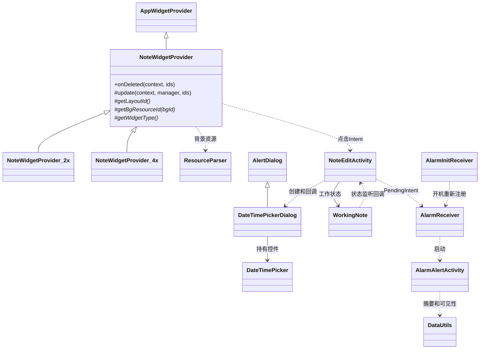
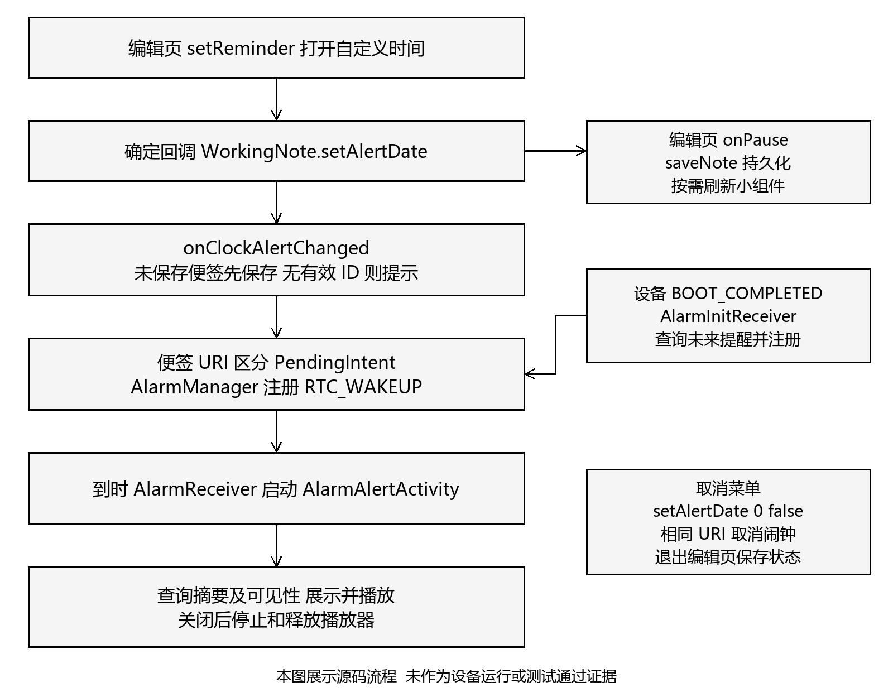
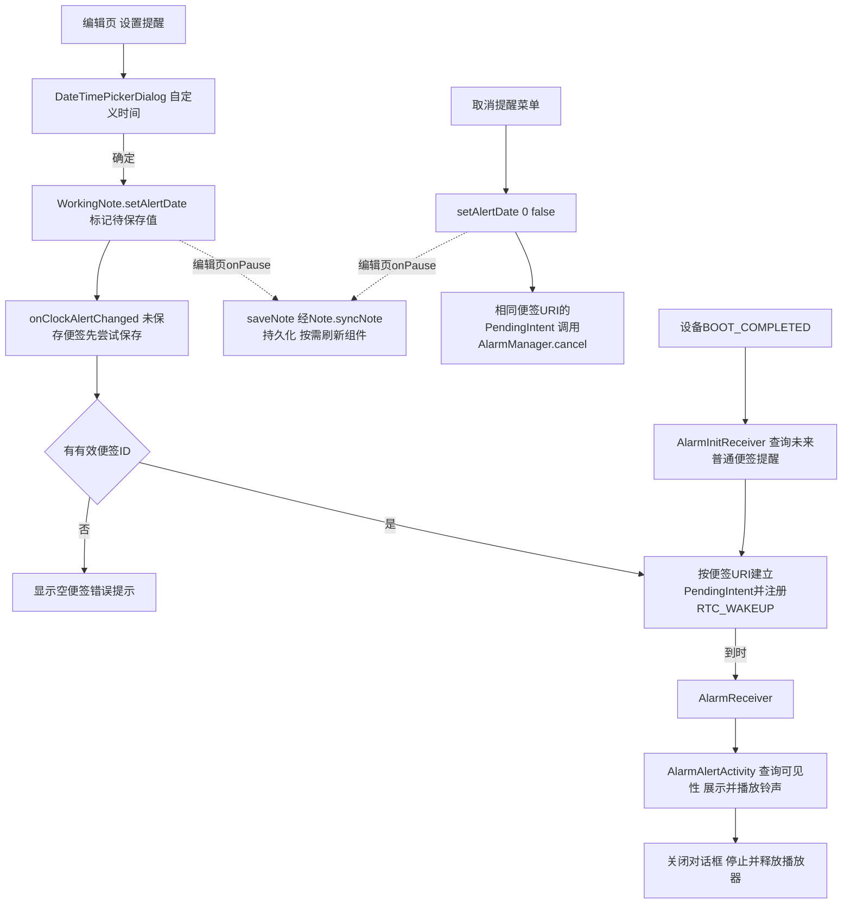

# B 模块源代码结构图

图示依据基线及本阶段阅读；只展示 B 负责的功能和相关依赖，不代表整个应用的完整 UML。PNG 在 assets 下，可供 Word 报告和后续小组 PPT 复用。箭头含义分别标明，不能将依赖箭头当成继承。

## 范围内用例

用例参与者为用户；范围内功能包括设置自定义提醒、取消提醒、查看提醒、通过桌面小组件查看和编辑便签。快捷提醒是下一阶段需求，未列为现有实现。

## 包依赖

此图是 B 范围的源码包依赖视图，不包含全部 gtask 依赖。tool → ui 的证据是 AppWidgetAttribute 与偏好键引用，widget → ui 的证据是点击目标 Activity 引用。没有独立 Widget Service。

## 关键类关系

## 提醒流程

现有便签设置提醒后，系统注册发生在回调中，数据库持久化依赖保存流程；两者不是同一个操作。普通应用重启与 BOOT_COMPLETED 恢复路径应分别验证。
