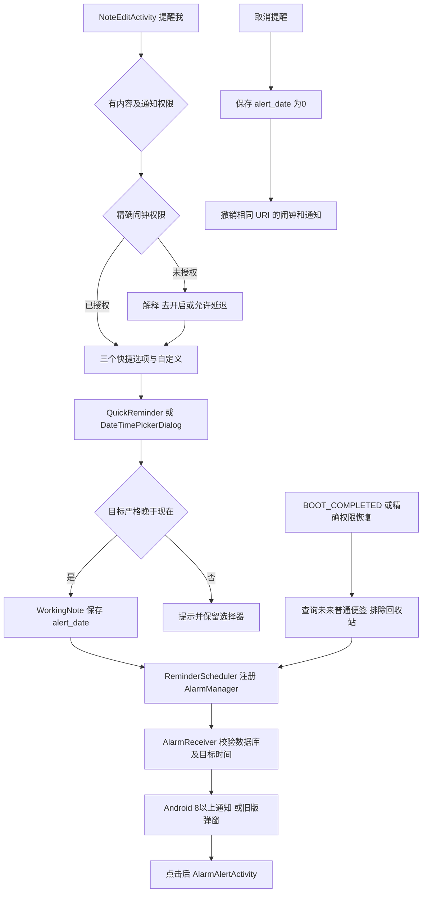

# B 模块第二阶段 快捷提醒维护

胡嘉豪　202430224010　2026-10-27

阅读成果与功能维护共用分支 `member/b-quick-reminder`，提交到 [PR #4](https://github.com/ttt587/Notes/pull/4)，目标 `develop`。第一阶段阅读提交保留为 `ec380f7c9da0c44d01d16c2284c4e563ba22a8a8`；本阶段沿用原来的类职责清单、详读和注释。

## 维护结果与操作

打开有内容的便签，菜单选择“提醒我”，可选“2 小时后”“明天上午 9:00”“一周后”，每项同时预览具体日期时间。最后一项“自定义日期和时间”进入原有滚轮选择器。点击时重新计算目标时间，避免弹窗停留过久使用旧预览。设置和取消都立即保存数据库，再调用统一调度器。

| 选项 | 时间规则 | 边界策略 |
| --- | --- | --- |
| 2 小时后 | 设备时区内增加两个经过的小时 | 自动跨天、跨年；秒与毫秒清零 |
| 明天上午 9:00 | 下一本地日的 09:00 | 不受今天 09:00 是否已过影响；跨月底和闰日 |
| 一周后 | 增加 7 个日历日，保留本地时分 | 跨夏令时仍保持本地钟表时间 |
| 自定义 | 用户选择的本地日期与时分 | 必须严格晚于当前时间；无效时保留弹窗，取消不保存 |

“2 小时后”按分钟精度保存，从有秒的当前时刻算起会少于整两小时不足一分钟，与原控件的分钟精度一致。所有预设均为单次提醒。设备变更时区之后已保存时间戳仍表示原来的绝对时刻；本次未增加随时区重算功能。

## 类职责和修改范围

| 文件 | 作用及变更 |
| --- | --- |
| `tool/QuickReminder.java`（新增） | 纯 Java 时间计算与未来时间判断；注入 now、TimeZone，便于确定性测试 |
| `tool/ReminderScheduler.java`（新增） | 统一按便签 URI 区分 PendingIntent，处理精确权限、取消、旧广播校验、通知渠道及通知点击 |
| `ui/NoteEditActivity.java` | 快捷选项、权限流程、自定义入口、设置与取消即时持久化；修正原可见性负号 |
| `ui/DateTimePickerDialog.java` | Q-B-01 的 12/24 小时格式；无效确认不关闭；整组设置 Calendar，清零秒与毫秒 |
| `ui/DateTimePicker.java` | 原子设置日期；修复月末进位、24 小时下午值、午夜跨日及 AM/PM 初始化 |
| `ui/AlarmInitReceiver.java` | 真实开机及精确权限恢复后，重新注册未来的普通非回收站便签提醒；finally 关闭 Cursor |
| `ui/AlarmReceiver.java` | 忽略已取消、删除、回收站、改期及尚未到时的广播；Android 8+ 发通知，旧版保留弹窗路径 |
| `ui/AlarmAlertActivity.java` | 通知点击复用原提醒页面；修正音频流类型，兼容空 URI/摘要，释放播放器并清除通知 |
| `tool/DataUtils.java` | Q-B-02 查询成功、空结果和读取异常均关闭 Cursor；相邻号码查询空结果也关闭 |
| `widget/NoteWidgetProvider.java` | 保留阅读注释，点击 PendingIntent 补 FLAG_IMMUTABLE；两个尺寸共用更新逻辑 |
| `AndroidManifest.xml` | 增加通知、精确闹钟权限及精确闹钟授权变化广播 |
| `res/values*/reminders.xml`、通知图标 | 英文、简体和繁体资源；白色通知时钟图标 |
| `tests/reminder/` | JVM 时间测试、原生 Android 验收、专用组件宿主及可复现集成脚本 |

第一阶段关键类阅读内容见 [phase-one-reading.md](phase-one-reading.md)。本表中的路径均相对 `src/net/micode/notes/`，Manifest、res、tests 除外。提交中的完整文件列表可运行 `git diff --name-status ec380f7..HEAD` 查看。

## 维护后的调用关系

## 系统行为与限制

Android 13+ 先请求通知权限，拒绝则提示且不设置提醒。Android 12+ 未授权精确闹钟时，界面解释可以去设置开启，也可以明确选择允许延迟，后者使用 `setAndAllowWhileIdle`，不能承诺准点。权限授权过程中发生撤销时捕获 SecurityException 并回退。Android 8+ 通过高优先级通知渠道发提醒，以适应后台 Activity 启动限制；点击通知才进入原提醒弹窗。

取消时同时清理 PendingIntent 和已有通知。接收器再次查询当前记录，阻挡取消、删除、回收站或已改期记录的旧广播。提醒响过后保留原始日期，便于查看，开机恢复仅查询未来记录。普通退出、进程回收与 Android“强行停止”不同；强停后系统会阻断后台广播，需用户重新打开应用。

构建使用 C 成员固定提交的共享配置，在独立副本集成测试；B 分支没有整体合并 C 源码。`develop` 在本次检查时尚未包含 Gradle 配置，组长集成时需先纳入共享构建/兼容性工作。Android 14、旧版设备、不同厂商省电策略和实际桌面拖放未执行；小组件使用真实 AppWidgetHost/RemoteViews 验证，截图明确标为测试宿主。

## 验证与证据

详细测试表、命令、原始日志、前后界面与通知截图见 [test-results.md](test-results.md)。第二阶段 Word 报告保留原模板章节，第一阶段报告保留历史状态。未运行 SonarQube，不给出其评级或覆盖率。
