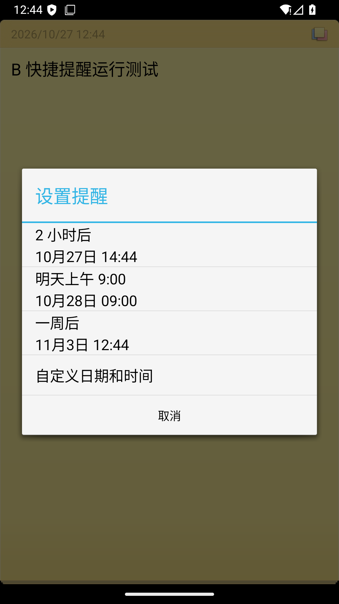
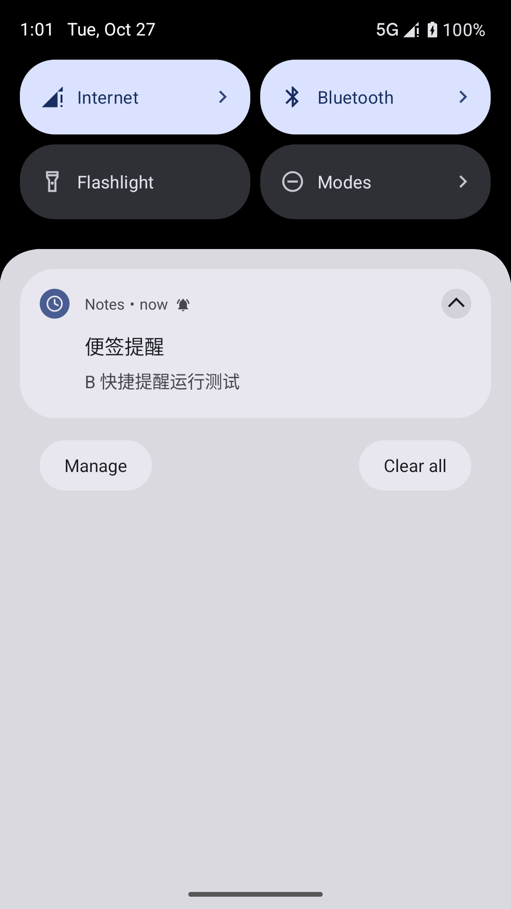
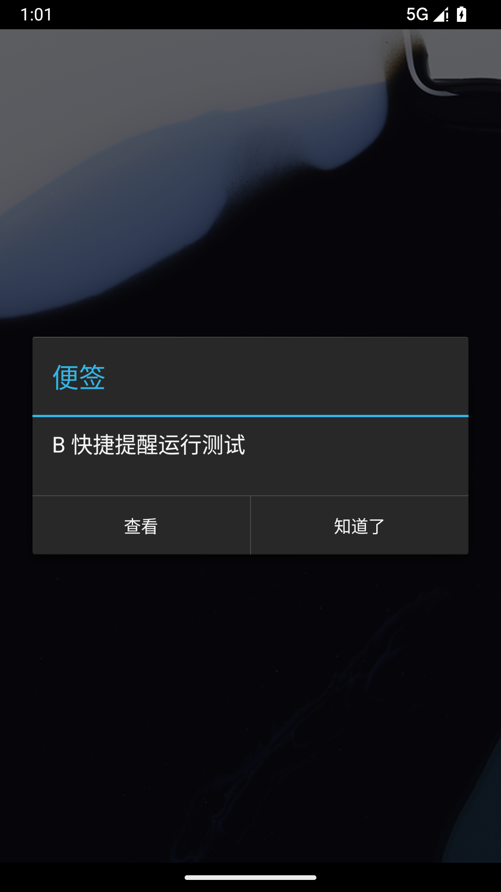
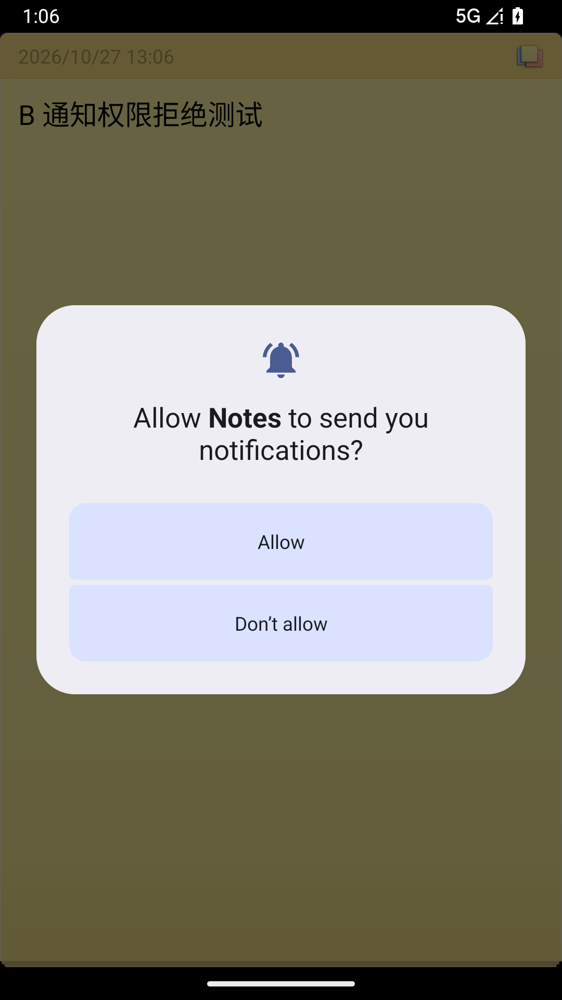

# B 模块第二阶段测试记录

执行日期：2026-10-27。记录人：胡嘉豪 202430224010。PR：[ttt587/Notes #4](https://github.com/ttt587/Notes/pull/4)。

## 环境与可复现范围

- Windows，JDK 21.0.10，Gradle 8.9，AGP 8.7.3，Android SDK 34。
- 任务专用模拟器：Android 16 / API 36、Google Play x86_64、1080×1920；WHPX，软件图形 swiftshader，关闭 Vulkan。
- 应用语言 zh-CN，**模拟器时区 GMT**；截图自 12:27 GMT（北京时间 20:27）开始，后续补抓截图保留各自设备时间。主机时区未改动。固定时间的 JVM 用例另行覆盖 Asia/Shanghai 和 America/New_York。
- 共享构建与兼容性基线为 C 成员提交 `09f4b0fec3444c91f6ec8a9a902cd5e3404ed5e7`。基线 APK 未覆盖 B 功能，用于修改前截图；测试 APK 在同一基线上覆盖 B 源码与资源。
- `tests/reminder/prepare_integration.py` 生成独立副本，保留 C Manifest 兼容配置，再合并 B 权限/恢复广播。测试额外注册独立 WidgetHostActivity，承载真实 AppWidgetHost/RemoteViews；生产 Manifest 不注册此入口。
- 本次不是 B 分支独立构建成功的声明：当前 develop 缺构建配置，组长需集成共享构建工作。未合并 C 的整体源码到 B PR。构建复现命令见 [测试说明](../../../tests/reminder/README.md)。

## 实际执行结果

| 测试组 | 检查内容 | 实际结果 | 原始证据 |
| --- | --- | --- | --- |
| 构建 | assembleDebug、assembleDebugAndroidTest、lintDebug | BUILD SUCCESSFUL | [build.log](evidence/logs/build.log) |
| JVM 时间边界 | 跨天、月底、年末、闰日、秒/毫秒、DST、过去/当前/未来及 null | 26 通过，0 失败 | [jvm-tests.log](evidence/logs/jvm-tests.log) |
| Android 主验收 | 快捷保存/取消、选择器、Cursor、小组件、真实触发、重启夹具 | 37 通过，0 失败 | [android-main.log](evidence/logs/android-main.log) |
| 精确权限拒绝 | 解释界面、选择允许延迟后保存且无崩溃 | 2 通过，0 失败 | [inexact.log](evidence/logs/inexact.log) |
| 通知权限拒绝 | 实际系统权限框，点击拒绝，数据库无提醒 | 4 通过，0 失败 | [notification-denied.log](evidence/logs/notification-denied.log) |
| 应用普通退出 | HOME + am kill，核对系统闹钟及再次打开的数据 | 1 持久化断言通过，闹钟仍存在 | [app-restart.log](evidence/logs/app-restart.log)、[系统记录](evidence/logs/alarm-after-app-kill.txt) |
| 实际设备重启 | adb reboot，等待 BOOT_COMPLETED，核对同一时间戳系统闹钟和数据库 | 1 持久化断言通过，系统闹钟恢复 | [reboot.log](evidence/logs/reboot.log)、[JSON](evidence/logs/reboot-evidence.json)、[系统记录](evidence/logs/alarm-after-reboot.txt) |
| C 共享质量约束 | XML、可变性标志、exported、冲突标记及同步源约束 | 8 通过 | [quality-tests.log](evidence/logs/quality-tests.log) |
| Android Lint | 整个集成副本的静态检查 | 0 错误，148 警告 | [完整清单](evidence/logs/lint.txt) |

原生 Android 验收合计 **45 个断言通过**（37+2+4+1+1）。Instrumentation 日志同时输出实时 PASS 和结尾汇总，不能把重复行算作新增用例。8 项共享质量约束是源码检查，不是系统运行覆盖率。未运行 SonarQube，未计算覆盖率，不承诺整库无缺陷。

## 场景与观察

| 编号 | 操作和输入 | 预期 | 实际  证据 |
| --- | --- | --- | --- | --- |
| T01 | 23:30 选 2 小时后；12 月 31 日同操作 | 跨日及跨年，分钟精度 | JVM 通过 [JVM 日志](evidence/logs/jvm-tests.log) |
| T02 | 1 月 31 日、4 月 30 日、平年/闰年 2 月末选明早 | 次日 09:00，月份正确 | JVM 通过 [JVM 日志](evidence/logs/jvm-tests.log) |
| T03 | 12 月 31 日选明早或一周后 | 年份进位 | JVM 通过 [JVM 日志](evidence/logs/jvm-tests.log) |
| T04 | 纽约 DST 春、秋变化 | 明早允许 23/25 小时间隔，一周后保留本地时分，2 小时为经过时间 | JVM 通过 [JVM 日志](evidence/logs/jvm-tests.log) |
| T05 | 实际点击三个预设，再逐项取消 | 即时保存、取消写 0 | 设备 6 个保存/取消断言通过 [选项](assets/tests/02-quick-options.png)、[保存](assets/tests/03-tomorrow-saved.png)、[取消](assets/tests/07-cancelled.png) |
| T06 | 选择器切 1 月到 2 月、闰日、年末午夜 | 正确年月日与 24 小时值 | 设备通过，另检查 00:00、12:00、23:59 [设备日志](evidence/logs/android-main.log) |
| T07 | 对话框从 2027-01-31 15:30 切到 2027-02-01 09:00 后确认 | 回调时间戳正确 | 设备通过 [设备日志](evidence/logs/android-main.log) |
| T08 | 自定义过去时间确认；取消自定义 | 不写入、无效时不关闭；取消无回调 | 设备通过 [自定义](assets/tests/04-custom-time-preserved.png)、[过去时间](assets/tests/05-past-time-rejected.png) |
| T09 | 同一对话框分别设置 24 小时、12 小时，选择 15:30 | 标题显示 15:30/3:30 且控件状态一致 | 设备通过，Q-B-01 修复 [12 小时格式](assets/tests/06-twelve-hour-format.png) |
| T10 | Cursor 成功、空、读取异常、null，号码查询空结果 | 非空 Cursor 总能关闭，保留原返回语义 | 设备 5 个断言通过，Q-B-02 修复 [Cursor 断言日志](evidence/logs/android-main.log) |
| T11 | 真实 2×2、4×4 组件，编辑绑定便签再保存 | 两尺寸显示正常，2×2 更新，无额外删便签 | 设备通过；截图为真实测试宿主 [组件更新前](assets/tests/08-widgets-before-edit.png)、[更新后](assets/tests/09-widgets-after-edit.png) |
| T12 | 安排 5 秒后提醒，保存后取消并等待 6.5 秒 | 过原定时刻无通知，数据库为 0 | 设备通过；取消旧广播也被拒绝 [取消状态](assets/tests/07-cancelled.png)、[等待结果](evidence/logs/android-main.log) |
| T13 | 安排 15 秒后提醒并按 HOME，等待真实 AlarmManager | 后台出现通知；点击进入原提醒页，关闭后清通知 | 设备通过，未用模拟触发广播替代 [后台通知](assets/tests/10-background-reminder-notification.png)、[提醒页面](assets/tests/11-reminder-alert.png) |
| T14 | 保存 2 小时后提醒，HOME + am kill，再打开 | 数据与系统闹钟保留 | 实际通过 [应用重启](assets/tests/after_restart.png)、[系统闹钟](evidence/logs/alarm-after-app-kill.txt) |
| T15 | 正常打开确认 stopped=false，HOME 后实际 adb reboot | 未来记录由开机接收器重新注册 | 相同便签 9 / 时间戳 1793112300000 重新注册，等待约 93.1 秒 [设备重启](assets/tests/after_reboot.png)、[系统恢复记录](evidence/logs/reboot-evidence.json) |
| T16 | appops deny 精确闹钟，点“继续，允许延迟” | 明确说明后可使用非精确回退，不崩溃 | 实际通过 [权限说明](assets/tests/12-exact-permission-explanation.png)、[延迟保存](assets/tests/13-inexact-fallback-saved.png) |
| T17 | revoke 通知权限，打开提醒并在系统框拒绝 | 提示未设置，alert_date 保持 0 | 实际通过 [系统请求](assets/tests/14-notification-permission-request.png)、[拒绝结果](assets/tests/15-notification-denied-no-reminder.png) |

## 截图索引

运行截图统一放在 `assets/tests/`，下表引用对应原始图片；构建及设备日志仍保存在 `evidence/logs/`。

| 证据 | 内容 |
| --- | --- |
| [01-before-custom-only.png](assets/tests/01-before-custom-only.png) | 修改前仅自定义选择器 |
| [02-quick-options.png](assets/tests/02-quick-options.png) | 三个快捷选项、具体时间预览和自定义入口 |
| [03-tomorrow-saved.png](assets/tests/03-tomorrow-saved.png) / [04-custom-time-preserved.png](assets/tests/04-custom-time-preserved.png) | 提醒保存、自定义入口保留 |
| [05-past-time-rejected.png](assets/tests/05-past-time-rejected.png) / [06-twelve-hour-format.png](assets/tests/06-twelve-hour-format.png) / [07-cancelled.png](assets/tests/07-cancelled.png) | 过去时间保留弹窗、12 小时制和取消状态 |
| [08-widgets-before-edit.png](assets/tests/08-widgets-before-edit.png) / [09-widgets-after-edit.png](assets/tests/09-widgets-after-edit.png) | 实际 AppWidgetHost/RemoteViews 测试宿主中的显示与更新；不是桌面拖放截图 |
| [10-background-reminder-notification.png](assets/tests/10-background-reminder-notification.png) / [11-reminder-alert.png](assets/tests/11-reminder-alert.png) | 真实后台提醒通知及点击后的原提醒页面 |
| [12-exact-permission-explanation.png](assets/tests/12-exact-permission-explanation.png) / [13-inexact-fallback-saved.png](assets/tests/13-inexact-fallback-saved.png) | 精确权限解释与允许延迟后的保存 |
| [14-notification-permission-request.png](assets/tests/14-notification-permission-request.png) / [15-notification-denied-no-reminder.png](assets/tests/15-notification-denied-no-reminder.png) | 实际系统通知授权请求与拒绝后的状态 |
| [after_restart.png](assets/tests/after_restart.png) / [after_reboot.png](assets/tests/after_reboot.png) | 应用退出和实际设备重启后的便签提醒状态 |

截图均取自模拟器原始像素，没有用绘制原型代替运行证据。05 的断言在确认后验证对话框仍打开；Toast 显示时间短，截图本身不作为 Toast 出现的唯一证据。

## 关键运行截图

快捷选项对应 T05，后台通知与点击后的提醒页对应 T13，系统权限请求对应 T17。完整的 17 张截图见上表。

## 遇到的问题及修正过程

1. HTTPS Git push 多次连接重置，切到 GitHub SSH 443 端口完成 fetch/push；PR 连接器写权限返回 403，因此使用已有 Git 凭据的内存认证 REST 请求提交 PR，没有保存或输出凭据。
2. 原项目没有构建文件。采用 C 的固定构建/兼容性提交建立独立集成副本，不把这一环境问题隐藏为 B 已可独立编译。
3. 初始模拟器图形后端退出，改为 swiftshader 并禁用 Vulkan，WHPX 正常运行。
4. local.properties 的盘符冒号与 CRLF 引发 Lint PropertyEscape，改为转义冒号与 LF；最终 0 错误。其余 148 警告保留，包含旧存储权限、布局以及通知图标低 API 兼容提示；没有宣称消除所有警告。
5. 首轮自动点击报 `No clickable UI text: 2 小时后`。列表行没有可用 ACTION_CLICK；按实际 Accessibility 文本节点的屏幕边界注入点击后通过，未更改应用以迁就测试。
6. 初始组件宿主直接替换 NoteEditActivity 的布局，恢复时 `initNoteScreen` 空指针；改成对话框后又遇到 singleTop 重用使 startActivitySync 等待。最终增加独立测试 WidgetHostActivity，保留生产编辑页生命周期，测试通过。这是测试夹具修正。
7. 直接在 `sys.boot_completed=1` 时读取系统闹钟过早，随后 Instrumentation 的强停又可能干扰尚未派发的广播。最后先正常打开解除 stopped 状态，真实重启，等待相同时间戳闹钟出现再开始 Instrumentation；约 93.1 秒后恢复。原始系统记录与 JSON 单独保存。
8. 逐张复核发现部分初始截图早于系统抽屉/权限框动画完成。增加等待、在实际权限按钮出现后截图，并单独重跑触发与权限分组；最终截图为重新采集的原始像素。补抓阶段关闭专用模拟器的窗口动画，避免过渡帧。重复触发的 4 个断言见 [trigger-capture.log](evidence/logs/trigger-capture.log)，不重复加入 45 项总数。

## 未覆盖范围

没有对真实手机、Android 14/旧 API、不同厂商省电/勿扰策略、通知渠道被用户关闭、系统时区变更后自动重算和桌面拖放执行实测。通知与精确权限测试结束后已恢复授权。强行停止会影响 Android 后台广播，不能用 am force-stop 冒充普通退出测试。第一阶段核验脚本只用于历史阅读提交，不能对功能变更后的源码继续要求 token 不变。
