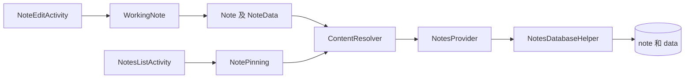

# 组长第一阶段 数据和模型模块阅读

负责人：组长。小组仓库为 `ttt587/Notes`，个人分支为 `member/leader-pin`。原始阅读基线是 `81a66024fe48eaa2206b854430856fe3875ff3ba`，维护实现基于包含 A、C 成果的 B 分支提交 `7feb4ef6bf7cb652978ac8cba9dc09a422c6334b`。

本模块连接编辑界面、便签业务状态和 SQLite 存储。阅读范围为 `data` 的 4 个原有类与 `model` 的 2 个原有类；维护阶段增加 `NotePinning`。

## 类与职责

| 类 | 职责 |
| --- | --- |
| `Notes` | 定义 Content URI、便签/文件夹类型、系统目录 ID、note/data 表字段和 MIME 类型 |
| `NotesDatabaseHelper` | 创建 note/data 两张表、维护触发器、创建系统目录并升级数据库 |
| `NotesProvider` | 按 URI 分派查询和增删改，更新 note 版本并发送数据变化通知 |
| `Contact` | 将通话便签中的号码映射为联系人名称，缓存已查到的结果 |
| `Note` | 收集 note、文本和通话数据的差异，将修改写入 ContentResolver |
| `WorkingNote` | 管理编辑中的正文、提醒、颜色和组件属性，向编辑页发送变更回调 |
| `NotePinning`（新增） | 定义稳定的列表排序，对合法普通便签执行本地置顶状态更新 |

## 关键调用链

界面没有直接执行 SQLite。`WorkingNote` 收集工作状态，`Note` 保存字段差异，Provider 负责统一数据入口。触发器维护文件夹计数、摘要与关联记录删除，因此数据库修改必须同时考虑表结构、触发器和 URI 通知。

## 三个关键类详读

### NotesDatabaseHelper

`CREATE_NOTE_TABLE_SQL` 保存便签元数据，`CREATE_DATA_TABLE_SQL` 保存实际文本及通话记录。`onCreate` 建表并注册触发器，`onUpgrade` 按版本逐步迁移。本次将版本 4 升至 5，增加默认值为 0 的 `pinned` 列；2、3、4 版升级链均在实际 SQLite 中验证了旧摘要、正文和修改时间保留。

原有版本 1 的升级逻辑会删表重建。重建函数引用当前建表语句，本次让该路径重建后直接返回，避免对当前表再次 ALTER。该历史路径仍具有原来的数据重置语义，不能把 2/3/4 版的数据保留结论套用到版本 1。

### NotesProvider

`query` 使用 UriMatcher 区分集合、单条记录与搜索。note/data 查询通过 SQLiteDatabase 执行，并为 Cursor 设置通知 URI。`update` 在修改 note 前增加版本号，完成后通知观察者。置顶只更新 `PINNED`，保留正文、修改时间和本地同步标记；同步元数据投影不增加该字段，所以当前置顶是本机偏好。

`increaseNoteVersion` 目前以字符串替换方式处理 selectionArgs，可维护性弱于参数绑定。本次置顶通过单条记录 URI 与固定数字筛选参数调用，未改写这一通用方法；其他自由文本调用场景仍应单独审查。

### WorkingNote 和 Note

`WorkingNote.setWorkingText` 等方法维护编辑中的业务状态；`saveNote` 必要时创建 note ID，再委托 `Note.syncNote` 写入 note 和 data。提醒值改变还会回调编辑页注册或取消系统闹钟。新增置顶不经正文编辑流程，以免把显示偏好误计为正文修改或影响字数统计。

`Note.syncNote` 在 note 更新返回 0 时会记录错误但继续，并清理差异集合。这是一项待进一步验证的保存一致性风险。本次未扩大到修改保存协议。

## 首轮问题与处理

| 编号 | 问题 | 本次状态 |
| --- | --- | --- |
| L-Q1 | 数据库升级与当前建表语句耦合，版本 1 重建后仍可能进入后续检查 | 保留原有重建语义并修正控制流；2/3/4→5 实测 |
| L-Q2 | `Contact.getContact` 在非空但无记录的 Cursor 分支未关闭游标 | 静态问题记录，未在本维护项修改 |
| L-Q3 | Provider 版本更新以字符串替换处理查询参数 | 静态问题记录，置顶调用使用固定数字参数 |
| L-Q4 | `Note.syncNote` 更新失败后的差异清理可能影响重试 | 待独立复现，不记作已修复 |

## 与组员成果的关系

A 负责编辑界面和字数统计，B 负责提醒、组件与工具，C 负责构建和兼容修复。本维护保留三人的源码，在列表层增加操作入口，在数据层增加字段和迁移。数据库升级、字段投影和列表展示是集成时的重点检查项。
