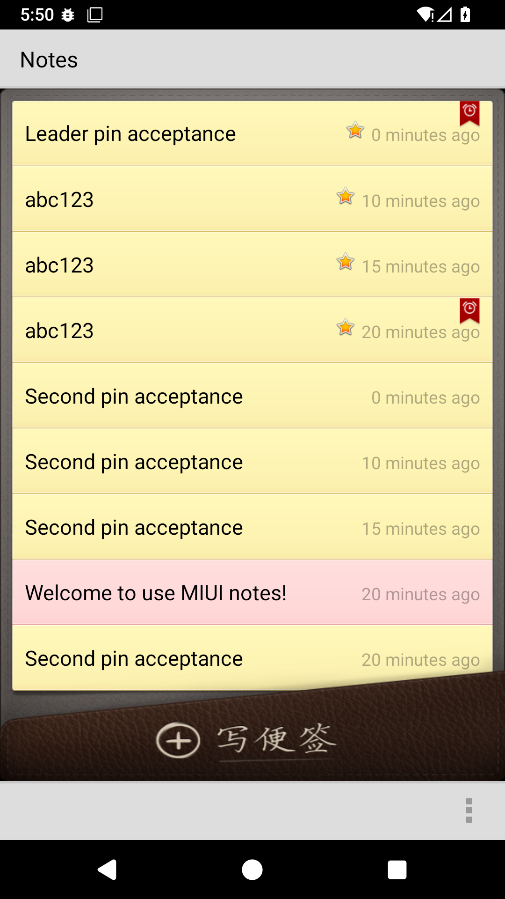
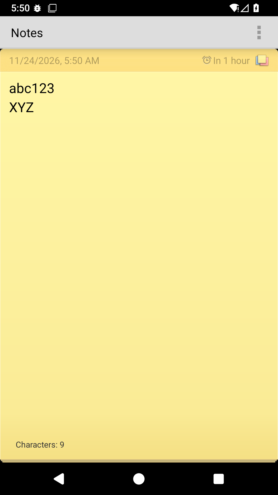

# 组长置顶功能测试记录

执行日期：2026-11-24（北京时间）。实现基线：`7feb4ef6bf7cb652978ac8cba9dc09a422c6334b`。

## 环境

- JDK：Android Studio 自带 OpenJDK 21.0.9。
- 离线编译：Android SDK Platform 36.1、Build Tools 36.1.0；目标 SDK 34，最低 SDK 14。
- 运行：独立 AOSP API 36 x86_64 模拟器，1080×1920；未使用或清除已有用户模拟器的数据。
- 团队固定配置保持 AGP 8.7.3、Gradle 8.9、compileSdk/targetSdk 34。
- 离线调试 APK SHA-256：`BCBB611DF520360A18B6E588A8E27A734661565B24AE21EF402C90CE8416E1C5`。
- Gradle 镜像 `mirrors.cloud.tencent.com` 域名解析失败，完整团队 Gradle 构建和 lint 本轮未完成；离线编译与设备验收单独记账。

## 实际结果

| 检查 | 结果 | 证据 |
| --- | --- | --- |
| 全部生产 Java、Android 资源、D8、签名打包 | 离线编译成功，两个 APK 安装成功 | [离线构建说明](../../../tests/pinning/README.md) |
| 旧库 2/3/4→5 | 版本、摘要、正文、修改时间保留，默认不置顶 | 主验收前 15 项 |
| 单条及批量置顶/取消 | 数量和持久化结果正确 | [主验收日志](evidence/pin-acceptance.log) |
| 无选择、系统目录、普通文件夹、回收站 | 不更新不合法目标 | 同上 |
| 排序与图标 | 文件夹顺序保留；置顶优先；星标和时钟同时可见 | 同上及截图 1 |
| 多选菜单到异步处理 | 实际菜单回调成功，退出选择后 ID 快照仍有效 | 同上 |
| A 的字数统计 | `abc123`、换行、`XYZ` 显示 9 | 同上及截图 2 |
| B 的提醒共存 | 对已置顶便签保存/取消提醒，置顶状态不变 | 同上 |
| 主验收合计 | 43 项通过 | 同上 |
| 进程强停后再次启动 | 置顶与编辑时间保持，2 项通过 | [重启日志](evidence/pin-restart.log) |
| C 的共享源码质量检查 | 8 项通过 | [质量检查日志](evidence/quality.log) |
| B 的 JVM 时间边界 | 26 项通过 | [时间边界日志](evidence/reminder-jvm.log) |

以上各组统计口径不同，分别列出，不将源码检查算成设备功能覆盖率。提醒实际触发、厂商后台策略、旧 Android 版本和远端 Google Tasks 不属于本轮新增验收范围。

## 原始运行截图

截图来自实际模拟器，保留原始像素。设备时间与显示语言采用模拟器设置，执行日期以本文北京时间记录为准。

## 复现与下一步

设备测试命令见 [tests/pinning/README.md](../../../tests/pinning/README.md)。主验收保存一条夹具供重启检查，设备强停测试只验证置顶数据库持久化，不用它证明提醒后台恢复。

合入最终 develop 后，在团队依赖已就绪的环境执行 `clean assembleDebug lintDebug`，保留实际日志和 lint 结果，再运行置顶验收及 B 的既有提醒验收。最终报告使用该集成提交的数据。
