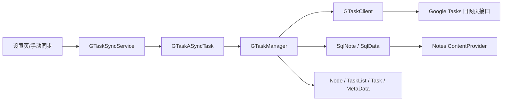

# 组员 C 第一阶段：同步 / 质量与构建模块代码阅读

## 1. 基本信息

- 成员：C（苏可）
- GitHub：`sophiasu051119-glitch`
- 仓库：`ttt587/Notes`（公开仓库）
- 工作分支：`member/c-build-quality`
- 阅读基线：`master` 的 `81a6602`（`Add RECEIVE_BOOT_COMPLETED permission`）
- 阅读日期：2026-10-21
- 阅读范围：`src/net/micode/notes/gtask/`、`AndroidManifest.xml`、仓库构建入口与工程配置

本阶段只提交代码阅读和质量问题记录，不修改业务代码。后续修复会在同一成员分支上单独提交，并补充复现、测试和截图证据。

## 2. 模块定位与调用关系

该模块把本地便签数据库映射为远端 Google Tasks 的任务列表、任务与元数据。入口是 Android `Service`，后台任务负责线程切换，管理器负责双向同步决策，客户端负责登录和 HTTP/JSON 通信。

关键数据流：

1. `GTaskSyncService.startSync(Activity)` 保存用于取令牌的 Activity，并启动 Service。
2. Service 创建 `GTaskASyncTask`；后台线程调用 `GTaskManager.sync(...)`。
3. Manager 登录远端、加载任务列表和元数据，再按“文件夹优先、便签随后”的次序比较本地与远端。
4. `Node.getSyncAction(Cursor)` 给出新增、删除、更新或冲突动作，Manager 分派动作。
5. `GTaskClient` 将动作编码为 JSON 请求；`SqlNote` / `SqlData` 把远端内容落入本地 ContentProvider。

## 3. 类与职责清单

模块共有 12 个 Java 类、2745 行代码。

| 包 | 类 | 职责 |
| --- | --- | --- |
| `gtask.data` | `Node` | 远端节点抽象基类；保存 GID、名称、修改时间、删除标记，并定义 9 种同步动作及 JSON/本地游标转换接口。 |
| `gtask.data` | `TaskList` | 远端任务列表/本地文件夹模型；生成增改请求，维护有序子任务集合，判断列表的本地/远端同步动作。 |
| `gtask.data` | `Task` | 远端任务/本地便签模型；维护完成状态、正文、前置兄弟和所属列表，负责任务 JSON 转换和冲突判定。 |
| `gtask.data` | `MetaData` | `Task` 的特殊子类；把本地便签结构化 JSON 保存到隐藏元数据任务，并通过 related GID 关联实际任务。 |
| `gtask.data` | `SqlNote` | 本地 note 行的领域包装；读取 note 与 data 子记录，计算差异并以可选版本校验方式提交到 ContentProvider。 |
| `gtask.data` | `SqlData` | 本地 data 行的包装；完成 JSON/ContentValues 转换、差异更新和版本约束下的写入。 |
| `gtask.remote` | `GTaskSyncService` | Android 同步入口；处理开始/取消命令，维护当前同步任务和进度，并广播同步状态。 |
| `gtask.remote` | `GTaskASyncTask` | 把耗时同步放入后台线程，发布进度通知，并把 Manager 的结果映射为成功、网络失败、内部失败或取消提示。 |
| `gtask.remote` | `GTaskManager` | 同步编排核心；加载远端图、建立 GID/NID 映射、比较本地和远端状态、执行双向增删改并刷新同步版本。 |
| `gtask.remote` | `GTaskClient` | 远端协议适配器；获取 Google 账号令牌、建立 cookie 会话、解析旧网页响应、批量提交 JSON 动作。 |
| `gtask.exception` | `NetworkFailureException` | 可恢复的网络/协议 I/O 失败；由 Manager 映射为 `STATE_NETWORK_ERROR`。 |
| `gtask.exception` | `ActionFailureException` | 数据、JSON 或同步动作不满足约束时的运行时异常；由 Manager 映射为 `STATE_INTERNAL_ERROR`。 |

补充：`GTaskASyncTask.OnCompleteListener` 是嵌套回调接口，用于同步完成后让 Service 清理任务并停止自身。

## 4. 关键类详细阅读与标注

### 4.1 `GTaskSyncService`：生命周期与入口

文件：[`src/net/micode/notes/gtask/remote/GTaskSyncService.java`](../../src/net/micode/notes/gtask/remote/GTaskSyncService.java)

| 行号 | 代码意图 | 阅读标注 |
| --- | --- | --- |
| 26–43 | 定义命令、广播字段和静态同步状态 | `mSyncTask` 同时承担“互斥锁”和任务引用；`mSyncProgress` 允许新进入的页面读取最近进度。静态字段跨 Service 实例存在，生命周期需要特别谨慎。 |
| 45–57 | `startSync()` 创建并执行异步任务 | 只在 `mSyncTask == null` 时启动，避免同一进程内重复同步；完成回调清空引用、广播空进度并 `stopSelf()`。 |
| 59–63 | `cancelSync()` | 取消不是直接终止线程，而是把 Manager 的取消标志设为真；各同步阶段在边界处协作检查。 |
| 71–86 | `onStartCommand(...)` 分派开始/取消命令 | 返回 `START_STICKY`，系统可能在进程被回收后用空 Intent 重建服务；当前代码未判空，这是质量问题 Q1。 |
| 100–106 | 同步进度广播 | 广播同时携带 `isSyncing` 和文本进度，供设置页更新 UI。广播 action 是普通字符串，未限制接收方。 |
| 108–119 | 对 UI 暴露静态开始/取消入口 | 开始前把 Activity 交给 Manager 用于账号令牌流程；取消通过再次启动 Service 发送命令。 |

### 4.2 `GTaskManager`：双向同步编排

文件：[`src/net/micode/notes/gtask/remote/GTaskManager.java`](../../src/net/micode/notes/gtask/remote/GTaskManager.java)

| 行号 | 代码意图 | 阅读标注 |
| --- | --- | --- |
| 51–99 | 单例状态与本次同步缓存 | 两张主表保存远端 TaskList/Node，元数据表补充便签结构，双向 GID/NID 表连接远端 ID 与本地数据库 ID。 |
| 114–169 | `sync(...)` 总控流程 | 用 `mSyncing` 拒绝重入；清空本次缓存，登录、初始化远端列表、同步内容；异常分为网络失败和内部失败；`finally` 保证清缓存并解除同步状态。 |
| 171–248 | `initGTaskList()` | 先找隐藏 meta list 并解析 related GID，再装入普通 MIUI 文件夹与任务，使每个 Task 可以附带原始本地 JSON 元数据。缺少 meta list 时会立即远端创建。 |
| 250–350 | `syncContent()` | 先处理回收站删除，再同步文件夹，然后遍历本地便签；匹配到的远端节点从 Map 移除，Map 剩余项即“仅远端存在”，最终新增到本地。 |
| 354–477 | `syncFolder()` | 根目录和通话记录目录有固定远端名称；普通文件夹按同步动作处理；文件夹先完成可保证后续任务能找到父列表的 GID/NID 映射。 |
| 479–523 | `doContentSync(...)` | 同步动作的集中分派点。冲突 `SYNC_ACTION_UPDATE_CONFLICT` 当前明确采用“本地覆盖远端”策略，注释承认尚未合并双方修改。 |
| 525–747 | 本地/远端增改与 meta 更新 | 新增本地节点时防止 ID 冲突；新增/更新远端任务时维护父子列表；每个普通便签还要同步一条 MetaData。 |
| 749–790 | `refreshLocalSyncId()` | 提交远端修改后重新拉取完整远端图，用远端最后修改时间刷新本地 `sync_id`，作为下次冲突判断基线。 |

### 4.3 `GTaskClient`：认证与旧协议访问

文件：[`src/net/micode/notes/gtask/remote/GTaskClient.java`](../../src/net/micode/notes/gtask/remote/GTaskClient.java)

| 行号 | 代码意图 | 阅读标注 |
| --- | --- | --- |
| 64–102 | 客户端单例与会话状态 | 目标不是现代 Google Tasks REST API，而是 `mail.google.com/tasks/ig` 旧网页接口；保存 HttpClient、cookie、client version、账号和待提交动作。 |
| 112–165 | `login(...)` | 登录态按 5 分钟过期；账号变化时重新登录；自定义域和官方域分别尝试，成功后复用会话。 |
| 167–208 | `loginGoogleAccount(...)` | 从 Android `AccountManager` 找设置中选定的 Google 账号并取 `goanna_mobile` 令牌。刷新分支忽略递归调用返回值，导致旧令牌继续被返回，这是质量问题 Q2。 |
| 210–281 | `tryToLoginGtask(...)` / `loginGtask(...)` | 首次登录失败会尝试刷新令牌；远端响应通过查找 `_setup(...)` 脚本片段提取 client version，对页面结构变化高度敏感。 |
| 294–324 | `getResponseContent(...)` | 兼容 gzip/deflate，逐行读取响应并在 finally 中关闭输入流；没有显式字符集，结果依赖设备默认编码。 |
| 326–361 | `postRequest(...)` | 将 JSON 放入表单字段 `r`，统一执行 POST 与响应 JSON 解析；I/O 错误映射为网络失败，JSON/其他错误映射为内部失败。 |
| 363–510 | 新增、批量更新、移动与删除 | 新增/移动/删除前先提交积压更新；普通更新缓存在 `mUpdateArray` 中以减少请求数量。 |
| 512–576 | 获取列表与列表内容 | 首页通过 HTML/脚本片段解析列表；指定列表通过 `get_all` 动作获取任务。两者均依赖非公开旧协议。 |

## 5. 首轮质量问题

### Q1（高）：粘性 Service 重建时空 Intent 可导致崩溃

- 位置：`GTaskSyncService.java:71-86`
- 证据：`onStartCommand` 第一条语句直接执行 `intent.getExtras()`；同一方法在处理有效命令后返回 `START_STICKY`。
- 触发路径：同步期间进程被系统回收 → Android 重建 sticky Service → 可能以 `intent == null` 回调 `onStartCommand` → 空指针异常。
- 影响：同步服务崩溃，用户只看到同步中断；不同系统版本/资源压力下具有偶发性。
- 建议：入口先判空，并根据产品语义选择 `START_NOT_STICKY`，或在空 Intent 时安全停止；增加服务重建测试。

### Q2（高）：刷新令牌后仍返回已失效的旧令牌

- 位置：`GTaskClient.java:192-201`，调用链见 `210-224`
- 证据：`invalidateToken == true` 时，代码先失效 `authToken`，再调用 `loginGoogleAccount(activity, false)`，但没有接收其返回值，函数最后仍返回原来的 `authToken`。
- 触发路径：首次 `loginGtask(oldToken)` 失败 → `tryToLoginGtask` 请求刷新 → 刷新函数取得新令牌但丢弃 → 第二次仍用 `oldToken` 登录。
- 影响：令牌过期后的恢复路径稳定失败，表现为同步网络错误。
- 建议：直接 `return loginGoogleAccount(activity, false);`，并通过可替换的认证接口编写“旧令牌失败、新令牌成功”的单元测试。

### Q3（阻塞）：仓库缺少可复现构建配置

- 位置：仓库根目录。
- 证据：仓库只有 `src/`、`res/`、`AndroidManifest.xml` 等源码资源；没有 `gradlew`、`build.gradle`、`settings.gradle`、`build.xml` 或 `project.properties`。
- 当前环境：JDK `21.0.10`；`ANDROID_HOME`、`ANDROID_SDK_ROOT` 为空；未发现 `adb` 或 `gradle` 命令。
- 影响：无法仅凭仓库记录的文件和版本执行可复现构建，也无法运行 Android lint 或安装冒烟测试。
- 建议：后续先补齐 Gradle Wrapper、Android Gradle Plugin/Gradle/JDK/compileSdk 版本矩阵，并记录从干净环境构建的完整命令与日志。旧 API（Apache HttpClient、`AsyncTask`、旧 Notification API、Google 私有接口）可能还需要兼容层或替换。

## 6. 第一阶段检查记录

| 检查项 | 命令/方法 | 结果 |
| --- | --- | --- |
| 拉取基线 | `git clone https://github.com/ttt587/Notes.git` | 成功，默认分支 `master`，基线 SHA `81a6602`。 |
| 建立个人分支 | `git switch -c member/c-build-quality` | 成功。 |
| 文件盘点 | `git ls-files`、`rg --files src/net/micode/notes/gtask` | 仓库 147 个跟踪文件；其中 39 个 Java、38 个 XML；本模块 12 个 Java 类。 |
| 类与方法定位 | `rg -n` 扫描类声明与方法声明 | 完成 12 个类的职责表和 3 个关键类的逐段标注。 |
| 构建入口检查 | 检查 Gradle/Ant/Maven 常用入口文件 | 未找到，记录为 Q3；本阶段无法执行真实构建与 lint。 |
| 质量问题 | 静态调用链阅读 | 记录 Q1、Q2 两个高优先级代码问题及 Q3 构建阻塞。 |

## 7. 后续计划

1. 先恢复可复现的最小构建链，保存工具版本、命令和完整失败日志。
2. 为 Q1、Q2 编写可复现测试，再分别提交最小修复，避免把构建迁移与行为修复混在一个提交中。
3. 运行可行的 lint/静态检查，按缺陷、坏味道、复杂度与安全告警分类汇总。
4. 完成安装启动与核心页面冒烟测试，并保存修复前后证据、运行截图和提交 SHA。
