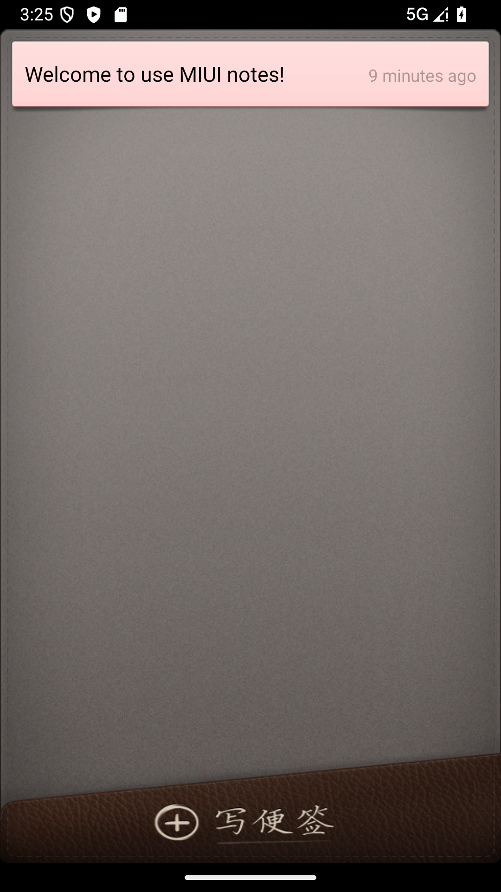
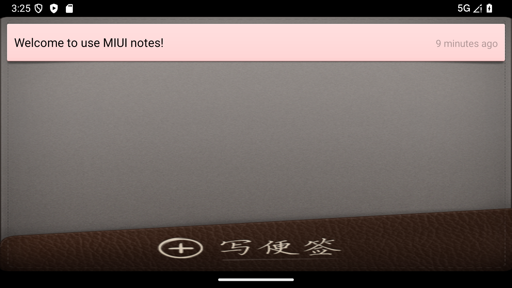
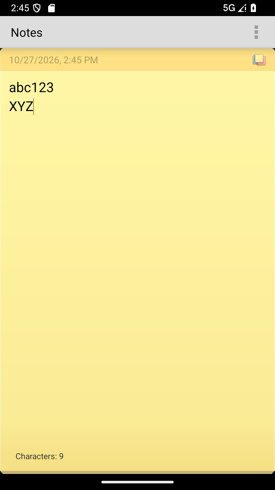
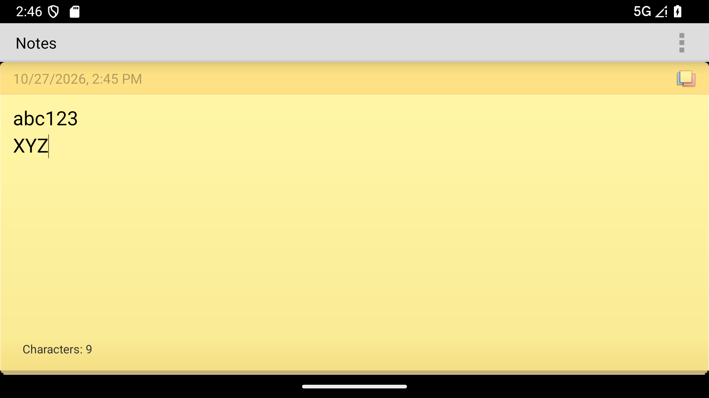

# 组员 C 第二阶段：统一构建、兼容修复与质量检查

- 负责人：苏可（组员 C）
- 分支：`member/c-build-quality`
- 模块：同步 / 质量与构建
- 验证日期：2026-10-27

## 1. 本阶段结论

本阶段已完成以下工作：

1. 将组员 A 提供的共享 Gradle 配置提交 `1ede4624123294c88b0d4a05fc7246c4075d11b9` 引入本分支，并保留提交作者与来源。
2. 在统一环境中完成 `clean + assembleDebug + lintDebug`，最终结果为 `BUILD SUCCESSFUL`。
3. 修复第一阶段记录的两个同步模块问题，并补充现代 Android 构建及运行兼容修复。
4. 新增 8 个可重复执行的源码级回归与仓库质量检查，全部通过。
5. 将 lint 从 9 个 error、147 个 warning 降至 0 个 error、130 个 warning。
6. 在 Android API 36 模拟器上完成最终 APK 的安装、冷启动、设置页、实时字数、横竖屏切换和崩溃日志检查。
7. 在组员 A 的 PR #3 合入 `develop` 后，将 `origin/develop`（`ed808ea`）合并回本分支，逐项解决 4 个冲突文件并完成全量复验。

## 2. 统一构建环境

| 项目 | 版本 / 配置 | 来源 |
| --- | --- | --- |
| AGP | 8.7.3 | `build.gradle` |
| Gradle | 8.9 | `gradle/wrapper/gradle-wrapper.properties` |
| JDK | 21.0.10 | 本机命令行验证 |
| compileSdk | 34 | `build.gradle` |
| targetSdk | 34 | `build.gradle` |
| minSdk | 14 | `build.gradle` |
| 运行验证系统 | Android API 36，`sdk_gphone64_x86_64` | Android Emulator |

共享配置包含 `build.gradle`、`settings.gradle`、`gradle.properties`、Gradle Wrapper 与 `.gitignore`。`local.properties`、`.gradle/`、`build/`、IDE 文件和 APK 等本地或构建产物均未纳入版本控制。

## 3. 构建与质量命令

### 3.1 源码级自动检查

```powershell
$env:PYTHONDONTWRITEBYTECODE='1'
python -m unittest discover -s tests/quality -p 'test_*.py' -v
```

结果：`Ran 8 tests`，`OK`。

覆盖内容：

- 服务收到空重启 Intent 时先判空，不再访问空对象；
- 服务改为 `START_NOT_STICKY`，避免无 Intent 的粘性重启；
- Google 认证令牌失效后返回新令牌，而不是丢弃递归调用结果；
- 同步通知不再调用已移除的 `setLatestEventInfo`；
- 同步进度广播仅限本应用包；
- 所有 PendingIntent 显式声明不可变；
- 所有带 intent-filter 的组件显式声明 `android:exported`；
- Manifest 与 `res/` 下 XML 均可解析，Java/XML 中不存在合并冲突标记。

### 3.2 完整构建与 lint

```powershell
.\gradlew.bat clean assembleDebug lintDebug --stacktrace
```

最终结果：

- `BUILD SUCCESSFUL in 3m 19s`（重新下载 Gradle Wrapper 后的完整执行）
- `40 actionable tasks: 40 executed`
- Debug APK 正常生成
- lint HTML/XML 报告正常生成
- 编译仅保留“JDK 21 编译 Java 8 source/target 已弃用”的警告，无编译错误

## 4. 问题复现、根因与修复

### C-Q1：粘性 Service 可能收到空 Intent 并崩溃

- 复现条件：系统回收并重新创建 `START_STICKY` 的 `GTaskSyncService`，重启时可能传入空 Intent。
- 原代码风险：进入 `onStartCommand` 后立即调用 `intent.getExtras()`，会触发空指针异常。
- 修复：在读取 extras 前判断 `intent == null`，调用 `stopSelf(startId)` 并返回 `START_NOT_STICKY`；正常路径也改为非粘性启动。
- 文件：`src/net/micode/notes/gtask/remote/GTaskSyncService.java`
- 回归检查：`test_service_checks_restart_intent_before_reading_extras`

### C-Q2：失效令牌刷新后仍返回旧令牌

- 复现条件：认证接口返回 401，代码令旧令牌失效并递归获取新令牌。
- 原代码风险：递归调用结果未返回，外层方法仍返回旧令牌，后续登录可能继续失败。
- 修复：改为 `return loginGoogleAccount(activity, false);`。
- 文件：`src/net/micode/notes/gtask/remote/GTaskClient.java`
- 回归检查：`test_invalidated_token_is_replaced_by_refreshed_token`

### C-Q3：Android 12+ 要求显式 exported

- 复现：统一配置第一次进入 Manifest 合并阶段时，5 个带 intent-filter 的组件报错，构建停止。
- 修复：启动页和外部编辑入口设为 `android:exported="true"`；小组件、开机接收器及仅应用内部使用的组件设为 `false`；移除已由 Gradle `namespace` 取代的 Manifest `package` 属性。
- 文件：`AndroidManifest.xml`

### C-Q4：旧通知 API 已从现代 SDK 移除

- 复现：`GTaskASyncTask` 调用 `Notification.setLatestEventInfo`，使用 SDK 34 编译时找不到该方法。
- 修复：改用 `Notification.Builder`；Android 8+ 创建同步通知渠道；声明并检查 Android 13+ 通知权限；PendingIntent 使用 `FLAG_IMMUTABLE`。
- 文件：`GTaskASyncTask.java`、`AndroidManifest.xml`

### C-Q5：旧资源 ID 与 AGP 8 不兼容

- 复现：旧代码在多个 `switch/case` 中使用 `R.id`，AGP 8 默认非 final 资源 ID 导致 17 个“需要常量表达式”错误。
- 修复：在 `gradle.properties` 中设置 `android.nonFinalResIds=false`，保持旧工程的编译期常量语义。

### C-Q6：Android 12+ PendingIntent 与广播安全要求

- 修复所有 PendingIntent，显式增加 `FLAG_IMMUTABLE`。
- Android 13+ 动态接收器使用 `RECEIVER_NOT_EXPORTED`。
- 同步进度 Intent 增加 `setPackage(getPackageName())`，防止隐式广播离开应用边界。
- 开机接收器显式校验 `Intent.ACTION_BOOT_COMPLETED`。

### C-Q7：UI 常量与布局质量问题

- 修复 `- View.VISIBLE` 的错误写法；虽然数值结果偶然等于 0，但会被 lint 判为错误常量。
- 为便签编辑页的内部 `LinearLayout` 显式指定纵向排列，避免子控件在默认横向布局中互相挤压。
- 将路径、文件名格式、数量格式和日期格式标记为不可翻译资源，清除无意义的缺失翻译错误。

## 5. lint 结果

| 阶段 | Error | Warning | 合计 |
| --- | ---: | ---: | ---: |
| 首次完整 lint | 9 | 147 | 156 |
| 合并 `develop` 后最终 lint | 0 | 130 | 130 |

最终剩余项均为 warning，主要分布如下：

| lint ID | 数量 | 后续处理建议 |
| --- | ---: | --- |
| `RtlHardcoded` | 33 | 逐步将 left/right 替换为 start/end，并做 RTL 界面回归 |
| `ContentDescription` | 26 | 为可交互图片补充无障碍描述 |
| `TypographyEllipsis` | 15 | 统一使用省略号字符或资源 |
| `UnusedResources` | 9 | 核实动态引用后再删除，避免误删旧主题资源 |
| `InflateParams` | 6 | 补充父 ViewGroup 以生成正确 LayoutParams |
| `StaticFieldLeak` | 5 | 清理 Activity/Context 的静态持有关系 |
| `ApplySharedPref` | 5 | 非立即读取场景改用 `apply()` |

这些 warning 已保留在 lint 报告中，没有通过全局关闭规则隐藏。

## 6. Android API 36 运行验证

最终 APK 在 Android API 36 模拟器中重新覆盖安装后执行以下验证：

| 测试项 | 结果 |
| --- | --- |
| `adb install -r -t` | `Success` |
| 冷启动 `NotesListActivity` | `Status: ok` |
| 冷启动耗时 | 2747 ms |
| 初始前台 Activity | `net.micode.notes/.ui.NotesListActivity` |
| 竖屏页面 | 欢迎便签与“写便签”按钮完整显示 |
| 实时字数 | 输入 `abc123`、换行、`XYZ`，显示 `Characters: 9`，换行未计数 |
| 横屏切换 | 编辑内容保留，字数仍为 9，`NoteEditActivity` 保持前台 |
| 设置页 | `NotesPreferenceActivity` 正常加载 |
| Notes 应用 AndroidRuntime 致命日志 | `NONE` |

API 36 模拟器镜像的 `com.google.android.bluetooth` 系统进程出现过 HCI 初始化失败日志；该进程与 Notes 应用包不同。复验时单独筛选 `AndroidRuntime:E`、`Process: net.micode.notes` 与 Notes 进程存活状态，均未发现 Notes 应用崩溃。

### 竖屏截图



### 横屏截图



### 合并后的实时字数竖屏截图



### 合并后的实时字数横屏截图



## 7. 最终 APK 信息

- 文件：`build/outputs/apk/debug/Notes-debug.apk`（构建产物，不提交）
- 大小：1,052,406 bytes
- SHA-256：`52EE6BA90A8658537A235E2E5C781B8C8443B07473C3F8447140A5E6BBCC9877`

## 8. 实际遇到的工程问题与解决过程

1. Gradle 8.9 首次从腾讯镜像下载较慢，但 Wrapper 校验和启动正常。
2. AGP 依赖首次从阿里云 Maven 镜像读取超时；延长连接与读取超时、复用已下载缓存后完成解析。
3. 本机最初只有 SDK 35/36，缺少统一配置要求的 Platform 34 与 Build-Tools 34.0.0；授权 SDK 目录后由 Gradle 自动补装。
4. 受控环境内无法访问 Hyper-V，API 36 AVD 返回 `0x80070005`；在获得权限后于宿主环境启动同一 AVD，最终完成真实安装测试。
5. 自动 XML 检查最初误扫描 `build/` 中的 lint 中间文件；将范围收紧为 Manifest 与 `res/` 源文件后，确保检查在增量构建目录存在时仍稳定通过。
6. 组员 A 的 PR #3 合入后，本分支与 `develop` 在 4 个文件发生内容冲突；按文件逐段比较双方改动并合并，没有用整文件覆盖任何一方。
7. API 36 模拟器的蓝牙系统进程存在与应用无关的 HCI 初始化日志；验证结论只依据 Notes 包名、Notes 进程和 AndroidRuntime 日志，不将系统镜像噪声误记为应用故障。

## 9. 修改文件清单

| 文件 | 主要改动 |
| --- | --- |
| `AndroidManifest.xml` | exported、通知权限、组件边界与定点 lint 说明 |
| `gradle.properties` | 兼容旧式 final 资源 ID |
| `GTaskSyncService.java` | 空 Intent、防粘性重启、包内广播 |
| `GTaskClient.java` | 返回刷新后的认证令牌 |
| `GTaskASyncTask.java` | Notification.Builder、通知渠道、权限检查、不可变 PendingIntent |
| `AlarmInitReceiver.java` | action 校验与不可变 PendingIntent |
| `NoteEditActivity.java` | 可见性常量与不可变 PendingIntent |
| `NotesPreferenceActivity.java` | Android 13+ 动态接收器导出标志 |
| `NoteWidgetProvider.java` | 不可变 PendingIntent |
| `res/layout/note_edit.xml` | 明确编辑区纵向布局 |
| `res/values/strings.xml` | 非语言型格式资源标记为不可翻译 |
| `tests/quality/*.py` | 8 个回归与仓库质量检查 |
| `docs/member-c/evidence/*.png` | API 36 主页面及合并后实时字数横竖屏运行证据 |

## 10. 仍需团队关注的风险

1. Google Tasks 同步依赖旧的非公开接口，接口现状不能仅通过本地冒烟测试证明可用；本阶段只修复可确定的本地控制流、认证令牌和兼容性问题。
2. lint 仍有 130 个历史 warning，已按类别汇总；其中 RTL、无障碍描述和静态 Context 持有应进入后续质量迭代。
3. Android 13+ 若用户未授予通知权限，同步任务会继续执行但跳过通知；后续可在合适的 Activity 中增加用户可理解的权限申请流程。
4. JDK 21 对 Java 8 source/target 的支持已进入弃用阶段；团队后续应选择固定较低 JDK toolchain，或评估提高源码级别。

## 11. 合并 `develop` 后的冲突处理

组员 A 的 PR #3 合入 `develop` 后，本分支执行了：

```powershell
git fetch origin
git switch member/c-build-quality
git merge origin/develop
```

合并基准为 `origin/develop` 的 `ed808ea`。4 个冲突文件及处理如下：

| 冲突文件 | 处理结果 |
| --- | --- |
| `AndroidManifest.xml` | 保留统一构建所需的 `tools` 命名空间、Android 12+ `exported` 声明和通知权限；系统接收器保持最小暴露面，不覆盖 A 的 UI/字数资源 |
| `gradle.properties` | 保留 A 的统一 Gradle 参数，同时保留旧项目在 AGP 8 下所需的 `android.nonFinalResIds=false` |
| `GTaskASyncTask.java` | 合并 A 的 `FLAG_UPDATE_CURRENT` 与按版本添加 `FLAG_IMMUTABLE` 的写法，并保留通知渠道、Android 13+ 权限判断和现代 `Notification.Builder` |
| `NotesPreferenceActivity.java` | 保留按 Android 版本注册接收器的兼容方法，Android 13+ 使用 `RECEIVER_NOT_EXPORTED`，旧版本仍可运行 |

冲突解决后的复验结果：

- 8/8 源码回归与仓库质量检查通过；
- `clean assembleDebug lintDebug` 完整成功；
- lint 为 0 error、130 warning；
- A 的实时字数控件、资源和监听逻辑仍存在，并在 API 36 上通过输入、换行、横竖屏验证；
- C 的设置页兼容修复通过实际页面启动验证；
- Java/XML 中不存在未解决的冲突标记。
